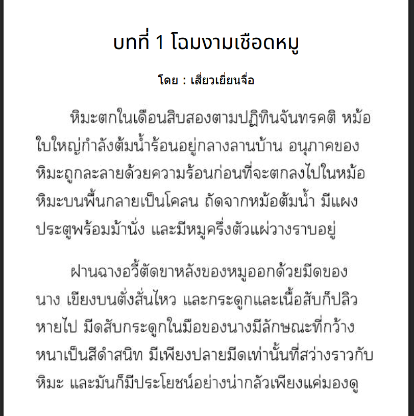

# 🔍 DISCOVERY — เอนจิน OCR ลับของ Windows (OneOCR)

*บันทึกการค้นพบ 18 ส.ค. 2026 · เครื่อง i5-13500 / RTX 4090 + RTX 3060 / Windows 11 build 26200*

---

## TL;DR

**Windows มีเอนจิน OCR อยู่ในเครื่องเราอยู่แล้ว ตัวหนึ่งที่อ่านภาษาไทยได้สมบูรณ์แบบ
รันบน CPU 0.17 วินาทีต่อรูป ไม่ต้องติดตั้งอะไรเพิ่ม ไม่ต้องมี NPU ไม่ต้องเน็ต —
แต่ Microsoft ไม่เคยประกาศ ไม่เคยเปิด API และไม่มีในเอกสารที่ไหนเลย**

ชื่อมันคือ **OneOCR** — ซ่อนอยู่ในแพ็กเกจ Snipping Tool มาตลอด เรียกใช้ได้ผ่าน ctypes ธรรมดา ๆ

---

## ไทม์ไลน์การค้นพบ

### ฉาก 1 — คำถามที่ดูเหมือนตอบง่าย

> "Windows OCR อ่านภาษาไทยได้ไหม"

เอกสาร Microsoft ให้คำตอบสองทาง และ**ทั้งสองทางคือทางตัน**:

| เอนจิน | สถานะ | อาการ |
|---|---|---|
| `Windows.Media.Ocr.OcrEngine` (รุ่นเก่า, Win10+) | ❌ ไม่มีไทย | catalog FOD มีแค่ ~36 ภาษา ไม่มี `th-TH` บนเครื่องไหนของ Windows — สแกน catalog จริงยืนยัน |
| `Microsoft.Windows.AI.Imaging.TextRecognizer` (รุ่นใหม่) | ❌ ใช้ไม่ได้ | เอกสารระบุ "run exclusively on devices with an NPU" — i5-13500 ไม่มี NPU |

AI ฟันธงปิดฉากไปแล้ว 2 รอบ ("ลงแพ็กภาษาไทยเพิ่มก็ได้" — ผิด, แพ็กไม่มีอยู่จริง /
"Snipping Tool ใช้เอนจินรุ่นเก่า" — ก็ผิด)

### ฉาก 2 — หลักฐานหนึ่งชิ้นที่ขัดกับทุกอย่าง

> ผู้ใช้: "ฉันใช้ Snipping Tool → Text Actions → Copy all text แล้วดูผล **ได้ภาษาไทยครบนะ**"

ประโยคเดียว ขัดกับเอกสารทั้งเล่ม — และมันคือความจริง
เพราะเครื่องไม่มี NPU และไม่มีแพ็กไทย แต่ Snipping Tool อ่านไทยได้จริง
สรุปได้ทางเดียว: **มันใช้เอนจินตัวที่สาม ที่ไม่มีในเอกสาร**

### ฉาก 3 — แกะแพ็กเกจ

Snipping Tool = แพ็กเกจ `Microsoft.ScreenSketch` ใน `C:\Program Files\WindowsApps\`
(โฟลเดอร์นี้**อ่านได้โดยไม่ต้อง admin** แค่ห้ามเขียน)

ในนั้น ข้างไฟล์โปรแกรม มีของที่ไม่ควรมีอยู่:

```
oneocr.dll          42.7 MB   ← เอนจิน
oneocr.onemodel     55.7 MB   ← โมเดล (เข้ารหัส)
onnxruntime.dll     14.0 MB   ← ตัวรันโมเดล
```

สแกน export table ของ oneocr.dll ได้ API 16 ฟังก์ชัน (`CreateOcrPipeline`,
`RunOcrPipeline`, `GetOcrLine`...) และมีคนกลุ่มเล็ก ๆ ใน GitHub ที่ reverse มันไว้แล้ว
(`AuroraWright/oneocr`, `b1tg/win11-oneocr`) พร้อม **คีย์ถอดรหัสโมเดล** ที่ขุดได้จากในตัว DLL เอง —
ล็อกประตูไว้ แต่แขวนกุญแจไว้ข้างประตู

### ฉาก 4 — รันจริง

ก๊อป 3 ไฟล์มาไว้ที่ `~/.config/oneocr/` + wrapper ctypes 388 บรรทัด → ปลุกเอนจินขึ้้นมา:

```
=== init: 0.78s ===   (โหลดโมเดลครั้งเดียว)
=== ocr:  0.17s ===   (ต่อรูป หลังจากนั้น)
```

---

## หลักฐานก่อน–หลัง (รูปเดียวกัน หน้าแรกนิยายแปล)

**รูปต้นฉบับ** (`samples/thai-novel-page.png`):



**เอนจินรุ่นเก่า (`Windows.Media.Ocr`)** — อ่านไทยด้วยพยัญชนะอังกฤษ เกะกะทั้งหน้า:

```
unn 1 IOUDIUIÜöQhLJ
fuzqntulåouäuaoo€njdt-lffuöuucanö
ttJtt8Qiånädåuth%uoQnanoanutjtnu
```

**OneOCR** — ออกมาเนียนพร้อมใช้ทันที (ตัดมา 6 บรรทัดแรก):

```
บทที่ 1 โฉมงามเชือดหมู
โดย : เสี่ยวเยี่ยนจื่อ
หิมะตกในเดือนสิบสองตามปฏิทินจันทรคติ หม้อใบใหญ่กำลังต้มน้ำร้อนอยู่กลางลานบ้าน อนุภาคของ
หิมะถูกละลายด้วยความร้อนก่อนที่จะตกลงไปในหม้อ
หิมะบนพื้นกลายเป็นโคลน ถัดจากหม้อต้มน้ำ มีแผงประตูพร้อมม้านั่ง และมีหมูครึ่งตัวแผ่วางราบอยู่
ฝานฉางอวี้ตัดขาหลังของหมูออกด้วยมีดของนาง เขียงบนตั่งสั่นไหว และกระดูกและเนื้อสับก็ปลิว
```

ไฟล์เต็ม: `output/Screenshot 2026-08-18 022038-oneocr.txt`

---

## ตัวเลขที่วัดจริงบนเครื่องนี้

| วัดอะไร | ได้เท่าไหร่ |
|---|---|
| init โมเดล (ครั้งเดียว/session) | 0.78 วิ |
| **OCR ต่อรูป** | **0.15–0.17 วิ** (CPU ล้วน) |
| การใช้ CPU | multithread ~6 คอร์ (CPU-time 5.9 เท่าของ wall-time, เครื่องมี 20 คอร์) |
| GPU ที่ใช้ | **0 MiB / 0%** ทั้ง RTX 4090 และ RTX 3060 |
| ข้อมูลที่ได้ | ข้อความ + ตำแหน่งบรรทัด + ตำแหน่งคำ + confidence ทุกคำ + มุมเอียงรูป |
| เทียบ Typhoon OCR 1.5-2B (RTX 3060) | Typhoon **~5–6 วิ/หน้า** vs OneOCR **0.17 วิ** = เร็วกว่า **~30 เท่า** (ดูด้านล่าง) |

## 🏁 เทียบกับ Typhoon บนเครื่องเดียวกัน

Typhoon OCR 1.5-2B (docker, RTX 3060) ที่กำลังทำงานอยู่จริงตอนบันทึกนี้ ใช้เวลา **~5–6 วิ/หน้า**

| เอนจิน | ต่อหน้า | ฮาร์ดแวร์ที่ใช้ |
|---|---|---|
| OneOCR | **0.17 วิ** | CPU (~6 คอร์) — ไม่แตะ GPU |
| Typhoon 1.5-2B | ~5–6 วิ | GPU RTX 3060 เต็มตัว |

→ OneOCR เร็วกว่า **~30 เท่า** โดยไม่ยุ่ง GPU เลย (รันคู่กับ Typhoon ได้พร้อมกัน)

ทำไมเร็วกว่า GPU ยักษ์ได้: โมเดลเล็กกว่ามาก (56MB vs 2B params) + งานต่อรูปเป็น
overhead-bound ไม่ใช่ compute-bound → GPU ไม่มีอะไรให้ช่วยอยู่แล้ว
(พิสูจน์แล้วว่า build ที่แถมเป็น CPU-only — ไม่มี CUDA/DirectML ถูก compile ในเลย)

---

## ทำไมเรื่องนี้ถึง WOW

1. **ของดีอยู่ในเครื่องเรามาตลอด** — ใครก็ตามที่ใช้ Windows 11 รุ่นใหม่ มีโมเดล OCR
   หลายภาษารวมไทย ติดมากับแผ่นอยู่แล้ว แต่ไม่มีปุ่มกดนอกจาก Snipping Tool/OneNote
2. **คุณภาพเกินราคา** — CPU ล้วน 0.17 วิ/รูป ไทยแม่นระดับใช้งานจริง วรรณยุกต์ครบ
   ไม่ต้องเน็ต ไม่ต้อง cloud ไม่ต้อง GPU
3. **ความปิดบังแบบแขวนกุญแจข้างประตู** — โมเดลเข้ารหัสระดับห้ามแตะ แต่คีย์ถอดรหัส
   อยู่ในตัว DLL ที่โหลดได้เองตลอดเวลา เรียกว่าล็อกหรอก แต่กุญแจอยู่ในกรอบเดียวกัน
4. **ช่องว่างระหว่าง "รุ่นเก่า" กับ "รุ่นใหม่" ที่เอกสารไม่เล่า** — เอกสารพูดแค่
   เอนจิน legacy (ไม่มีไทย) กับ TextRecognizer (ต้อง NPU) ทั้งที่ของจริงที่ใช้อยู่วันนี้
   คือตัวที่สามที่ไม่มีบันทึกสาธารณะ
5. **ผู้ใช้ชนะเอกสาร** — การค้นพบนี้เกิดจากผู้ใช้ลองจริง ("ได้ภาษาไทยครบนะ")
   ขัดกับความเชื่อทั้งหมด แล้วความจริงอยู่ข้างผู้ใช้ ไม่ใช่ข้างเอกสาร

---

## บทเรียน

- **ทดลองจริง > อ้างเอกสาร** — เอกสารบอกว่าทำไม่ได้ แต่ของบนเครื่องบอกว่าทำได้
  ถ้าผลการทดลองขัดกับทฤษฎี เชื่อการทดลอง แล้วไปหาคำอธิบาย
- **AI vision ตัวเล็ก hallucinate การอ่านภาพได้ทั้งหน้า** — ระหว่างทางเคยใช้ AI
  อ่านรูปเดียวกันทำ ground truth ปรากฏว่ามัน**เล่าเรื่องมั่วทั้งหมด** (อ้างว่าเป็น
  เอกสารโครงการ ทั้งที่จริงคือนิยาย) — ground truth ต้องมาจากเอนจินจริงเท่านั้น
- **เครื่องมือเร็วที่สุด มักไม่ใช่โมเดลใหญ่ที่สุด** — งาน overhead-bound บน CPU
  6 คอร์ ชนะ GPU ยักษ์ที่โหลดโมเดลพันล้านพารามิเตอร์

---

## ใช้งาน

โครงสร้างโปรเจค (clone จาก `github.com/panupongkongkate/win-ocr`):

```
DISCOVERY.md                 ← ไฟล์นี้ (เรื่องเล่า)
README.md                    ← วิธีใช้ (สำหรับคน clone)
example.py                   ← ตัวอย่างเรียกใช้: python example.py รูป.png
oneocr/oneocr.py             ← wrapper ctypes (จาก github.com/AuroraWright/oneocr)
oneocr/{oneocr.dll, oneocr.onemodel, onnxruntime.dll}
                             ← เอนจิน+โมเดล แนบมากับ repo ใช้ได้ทันที
output/                      ← ผลทดสอบ
```

ใช้งาน (Windows 10/11 x64, ต้องมีแค่ Python + Pillow):

```bash
git clone https://github.com/panupongkongkate/win-ocr.git
cd win-ocr && pip install pillow
python example.py samples/thai-novel-page.png
```

wrapper โหลดโมเดลจากโฟลเดอร์ `oneocr/` ของ repo อัตโนมัติ
(ถ้ามี `~/.config/oneocr/` จะใช้ของตำแหน่งนั้นก่อน)

ข้อจำกัด: รูปต้องกว้าง/สูง 50–10000 px; ไม่มีทางเลือก execution provider (CPU เท่านั้น);
เป็น API ไม่เป็นทางการ อาจหายไปเมื่อ Windows อัปเดต (ถ้าหาย ก๊อปใหม่จากแพ็กเกจ ScreenSketch รุ่นใหม่)
