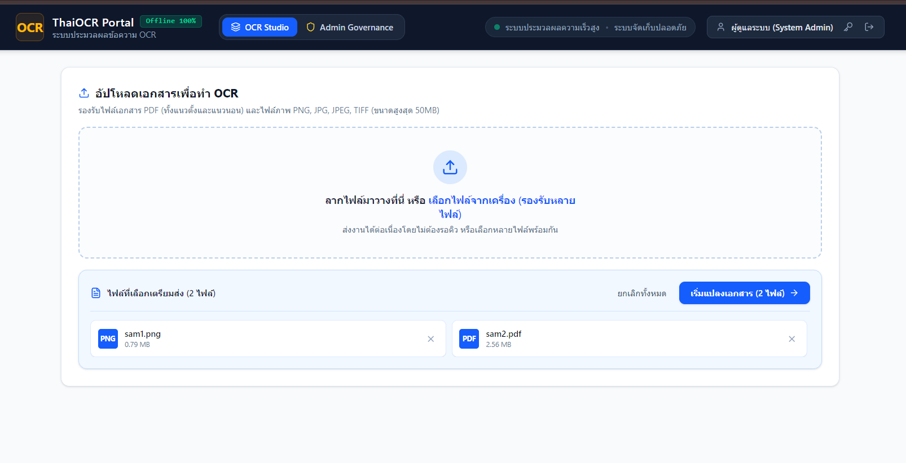
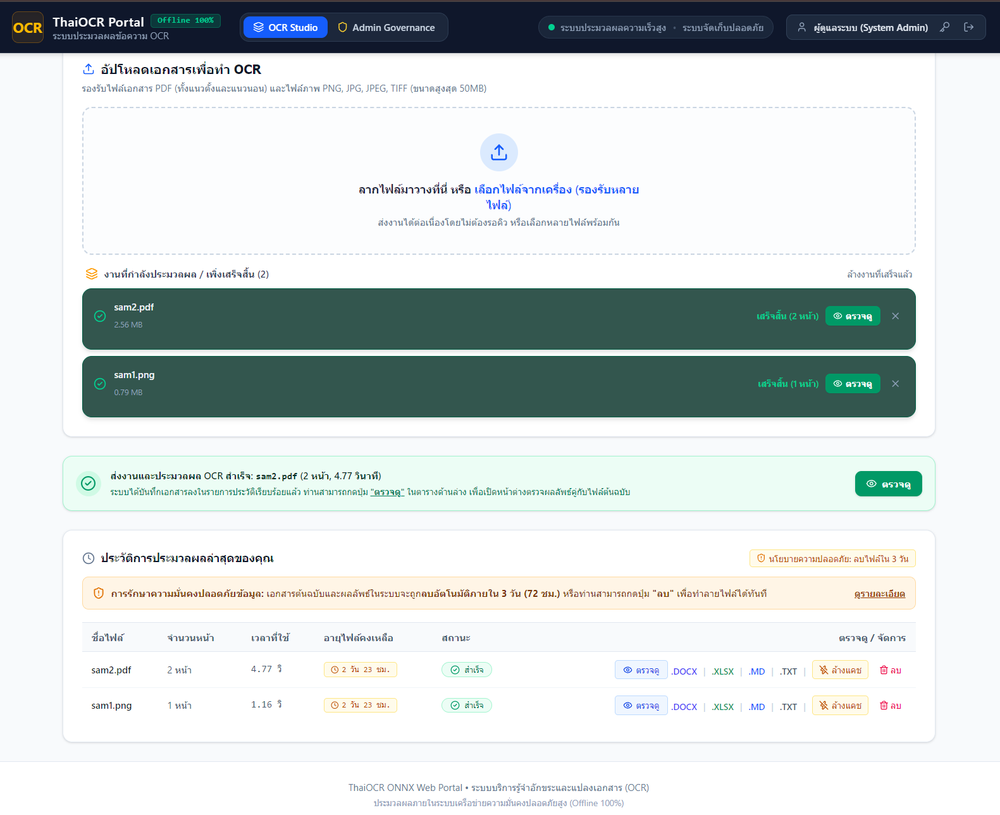
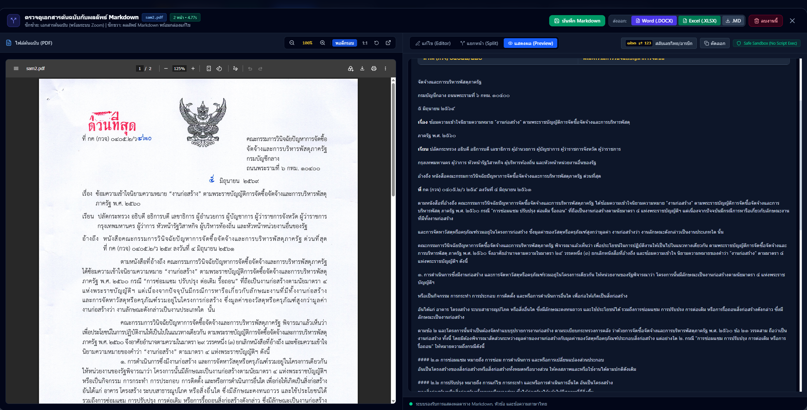
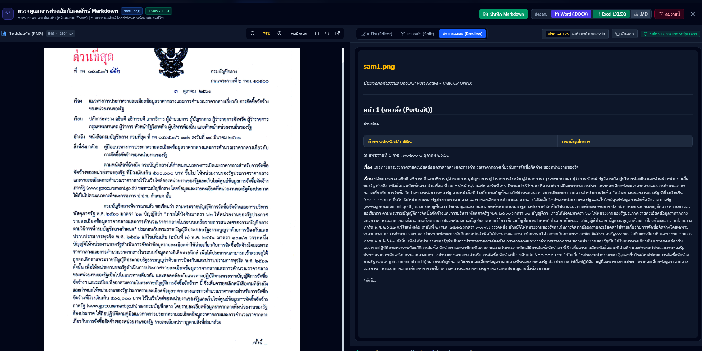

# ThaiOCR ONNX: อ่านภาษาไทยจากรูปและ PDF เป็น Markdown บน CPU (Offline 100%)

ระบบ OCR ภาษาไทย (และอีกหลายภาษา) ด้วย **OneOCR** เอนจินเดียวกับ Snipping Tool Text Extractor ใน Windows 11
- **CPU ล้วน ~0.17 วิ/รูป** ไม่ต้องต่อเน็ต ไม่ต้อง GPU/NPU ไม่ต้องสิทธิ์ Admin โมเดลและเอนจินแนบมาใน Repo ครบ
- **Offline 100% ตรวจสอบแล้ว:** DLL ไม่มีการ socket/network DLLs ใด ๆ ปลอดภัยสำหรับข้อมูลภายใน
- **รองรับทั้งรูปภาพและ PDF:** มีสคริปต์แปลง PDF หลายหน้าเป็น **Markdown (.md)** พร้อมระบบ Auto-rotate และตรวจจับตาราง
- **Full Web Portal & REST API:** มาพร้อมเว็บแอปพลิเคชัน UI ที่ทันสมัย และ REST API สำหรับเชื่อมต่อระบบภายนอก
- **Multi-platform Deployment:** รองรับทั้งรันบน Windows Native และ Linux Docker (Rust Native Engine Zero-Windows Dependency)

📖 เบื้องหลังการค้นพบอ่านได้ที่ [DISCOVERY.md](DISCOVERY.md)

---

## ภาพตัวอย่างการใช้งานระบบ (System Screenshots)

| 1. หน้าเข้าสู่ระบบ (Secure Authentication) | 2. หน้าแดชบอร์ดจัดการคิวงาน OCR (OCR Studio) |
|---|---|
|  |  |

| 3. ตรวจดูเอกสารต้นฉบับเทียบกับ Markdown (Side-by-Side) | 4. ตัวจัดการผลลัพธ์และส่งออก Markdown / TXT |
|---|---|
|  |  |

---

## สารบัญ
- [สิ่งที่ต้องมี](#สิ่งที่ต้องมี)
- [ภาพตัวอย่างการใช้งานระบบ](#ภาพตัวอย่างการใช้งานระบบ-system-screenshots)
- [1. ใช้งานแปลง PDF เป็น Markdown (pdf_to_md.py)](#1-ใช้งานแปลง-pdf-เป็น-markdown-pdf_to_mdpy)
- [2. ใช้งานอ่านข้อความจากรูปภาพ (example.py)](#2-ใช้งานอ่านข้อความจากรูปภาพ-examplepy)
- [3. เรียกใช้จากโค้ด Python ตัวเอง](#3-เรียกใช้จากโค้ด-python-ตัวเอง)
- [4. คุณสมบัติและความปลอดภัย (Offline 100%)](#4-คุณสมบัติและความปลอดภัย-offline-100)
- [5. ตัวเลขประสิทธิภาพการทำงาน](#5-ตัวเลขประสิทธิภาพการทำงาน)
- [6. ที่มาของไฟล์](#6-ที่มาของไฟล์)
- [7. คู่มือการติดตั้งบน Ubuntu Server (Deployment Guide)](#7-คู่มือการติดตั้งบน-ubuntu-server-deployment-guide)
- [8. สถาปัตยกรรม Rust Native บน Linux Docker (แนะนำสูงสุด)](#8-สถาปัตยกรรม-rust-native-บน-linux-docker-แนะนำสูงสุด---zero-windows-dependency)

---

## สิ่งที่ต้องมี

- **Windows 10/11 64-bit** (สถาปัตยกรรม x64 / AMD64)
- **Python 3.10+**
- แพ็กเกจที่ใช้:
  ```bash
  pip install pillow pymupdf
  ```
  *(ถ้าใช้เฉพาะอ่านรูปภาพ ติดตั้งแค่ `pillow` ก็เพียงพอ)*

---

## 1. ใช้งานแปลง PDF เป็น Markdown (pdf_to_md.py)

แปลงไฟล์ PDF สแกนออกมาเป็นไฟล์ Markdown (`.md`) โครงสร้างเรียบร้อย

```bash
# แปลงทั้งไฟล์ PDF ออกมาเป็น Markdown
python pdf_to_md.py samples/sam2.pdf -o output/sample.md

# กำหนดช่วงหน้าที่ต้องการประมวลผล
python pdf_to_md.py samples/sam2.pdf -o output/sample.md --pages 1-3,5

# ปรับความละเอียด DPI (ค่าเริ่มต้น 150)
python pdf_to_md.py samples/sam2.pdf -o output/sample.md --dpi 200
```

### ฟีเจอร์เด่นใน PDF Pipeline:
1. **Auto-rotate:** หมุนรูปภาพให้อัตโนมัติตามมุมเอียงของตัวอักษรจริง (0°, 90°, 180°, 270°)
2. **Table Detector:** ตรวจจับข้อมูลตารางและแปลงเป็น Markdown Table (`| คอลัมน์ 1 | คอลัมน์ 2 |`) อัตโนมัติ
3. **Smart Heading & Paragraphs:** แยกแยะหัวข้อใหญ่, หัวข้อย่อย (๑., ๒., 3.), และข้อความย่อหน้าต่อเนื่อง
4. **Zero-Poppler:** เรนเดอร์ PDF ผ่าน PyMuPDF ใน Memory ไม่ต้องติดตั้งโปรแกรมหรือ tool เสริมใน Windows

---

## 2. ใช้งานอ่านข้อความจากรูปภาพ (example.py)

```bash
# แสดงผลลัพธ์ออกทาง Terminal
python example.py samples/sam1.png

# เซฟผลลัพธ์ลงไฟล์ข้อความ
python example.py samples/sam1.png -o output/result.txt
```

---

## 3. เรียกใช้จากโค้ด Python ตัวเอง

```python
import sys
from pathlib import Path
from PIL import Image

# ชี้ path ไปที่โฟลเดอร์ oneocr
sys.path.insert(0, r"path\to\oneocr")
import oneocr

# โหลด Engine (โหลดครั้งเดียว ~0.8 วิ แล้วใช้ซ้ำได้ตลอด)
engine = oneocr.OcrEngine()

# ทำ OCR จาก PIL Image
img = Image.open("samples/sam1.png")
result = engine.recognize_pil(img)

print("ข้อความทั้งหมด:")
print(result["text"])
print("มุมเอียงของข้อความ:", result["text_angle"])
```

โครงสร้างข้อมูลที่ส่งกลับมา:
```python
{
  "text": "...",          # ข้อความทั้งหมดคั่นด้วย \n
  "text_angle": 0.09,     # องศาความเอียงของข้อความ
  "lines": [
    {
      "text": "...",
      "bounding_rect": {"x1": 0, "y1": 0, "x2": 100, "y2": 0, ...},
      "words": [
        {"text": "...", "confidence": 0.99, "bounding_rect": {...}}
      ],
    },
  ],
}
```

---

## 4. คุณสมบัติและความปลอดภัย (Offline 100%)

- **ไม่มีการต่อเน็ตแน่นอน 100%:**
  - รัน Dependency Walker (`dumpbin /dependents oneocr.dll`) พบว่าลิงก์เฉพาะ `KERNEL32.dll`, `ADVAPI32.dll`, `MSVCP140.dll`
  - ไม่มี `WS2_32.dll` (Winsock) หรือ `WININET.dll` ใด ๆ
  - ทดสอบ Monkeypatch ดักจับ Socket & DNS connection ใน Python ระหว่างรัน OCR พบเป็น 0 ครั้ง
  - ปลอดภัยสำหรับการประมวลผลเอกสารลับ / ข้อมูลส่วนบุคคล (PDPA) / ข้อมูลภายในองค์กร

---

## 5. ตัวเลขประสิทธิภาพการทำงาน

| รายการ | ค่า |
|---|---|
| Initial Load Engine | ~0.78 วิ (ครั้งเดียวต่อโปรแกรม) |
| OCR ต่อรูป (CPU) | **0.15–0.17 วิ/รูป** |
| OCR PDF หลายหน้า | **~0.9–1.5 วิ/หน้า** (รวมเรนเดอร์ภาพ + Auto-rotate + จัดตาราง Markdown) |
| เอกสารสแกนหลายหน้า (`samples/sam2.pdf`) | **~1-1.5 วินาที/หน้า** |
| ทรัพยากรเครื่อง | CPU ล้วน ~6 คอร์ (ไม่ใช้ GPU/NPU) |
| ความแม่นยำภาษาไทย | แม่นยำสูง ทั้งวรรณยุกต์ สระ ตัวเลขไทย และตารางตัวเลขซับซ้อน |

---

## 6. ที่มาของไฟล์

- `oneocr/oneocr.py` — wrapper ดั้งเดิมจาก [AuroraWright/oneocr](https://github.com/AuroraWright/oneocr) (ปรับปรุง fallback ให้โหลดไฟล์ dll ใน repo อัตโนมัติ)
- `oneocr/` (oneocr.dll, oneocr.onemodel, onnxruntime.dll) — binary ของ Microsoft ที่มาพร้อมกับ Windows Snipping Tool (`Microsoft.ScreenSketch`)
- `pdf_to_md.py` — สคริปต์แปลง PDF เป็น Markdown พร้อม Auto-rotate และ Table Parser
- ⚠️ เป็น API ภายในของระบบ Windows

---

## 7. คู่มือการติดตั้งบน Ubuntu Server (Deployment Guide)

เนื่องจาก `oneocr.dll` เป็น PE32+ DLL สำหรับ Windows x64 โดยเฉพาะ หากต้องการนำระบบไปให้บริการบนเครื่องเซิร์ฟเวอร์ Linux / Ubuntu ให้ใช้รูปแบบใดรูปแบบหนึ่งดังนี้:

### แนวทางที่ 1: Hybrid Architecture (แนะนำสำหรับ Production ใช้งาน Windows Worker)
แยก Web Application และ OCR Worker ออกจากกัน:
- **Ubuntu Server (Host หลัก):** รัน `docker-compose.yml` (Web Portal + Garage S3 + SQLite)
- **Windows Server VM (Worker):** รันบน Hyper-V / VMware / Proxmox รัน `python ocr_worker.py` (Port 8001)
- **การตั้งค่า Environment ใน `docker-compose.yml` ฝั่ง Ubuntu:**
  ```yaml
  environment:
    - OCR_WORKER_URL=http://<IP-WINDOWS-VM>:8001
  ```

---

### แนวทางที่ 2: All-in-One บน Ubuntu ด้วย KVM/QEMU Windows Container (`dockur/windows`)
รันทุกอย่างบน Ubuntu Server เครื่องเดียว โดยใช้ KVM Virtualization รัน Windows Container:

1. **เตรียมสภาพแวดล้อมด้วยสคริปต์อัตโนมัติ:**
   ```bash
   chmod +x setup-ubuntu.sh
   ./setup-ubuntu.sh
   ```

2. **การทำงานของระบบอัตโนมัติ (Automated OEM Provisioning):**
   - เมื่อรัน `docker compose -f docker-compose.ubuntu.yml up -d`
   - คอนเทนเนอร์ `windows-ocr-worker` จะดึงอิมเมจ `dockurr/windows` มารันด้วย KVM
   - ระบบจะแมปไดรฟ์โค้ดเข้าไปที่ `Z:\` และโฟลเดอร์ `oem/` เข้าไปที่ `C:\OEM\`
   - Windows จะรันสคริปต์ `install.bat` เพื่อตั้งค่า Firewall และรัน `run_ocr_worker.bat` อัตโนมัติ
   - เมื่อ Windows บูตเสร็จ OCR Worker พอร์ต 8001 จะเปิดให้บริการทันที และ `thai-ocr-app` จะเชื่อมต่อผ่านเครือข่าย Docker ภายในอัตโนมัติ

3. **คำสั่งสั่งงานและตรวจสอบ:**
   ```bash
   # เริ่มต้นทุกบริการ
   docker compose -f docker-compose.ubuntu.yml up -d

   # ตรวจสอบหน้าจอติดตั้ง Windows ครั้งแรกผ่านเบราว์เซอร์
   http://<IP-Ubuntu>:8006 (Web VNC)

   # ตรวจสอบสถานะ OCR Worker
   curl http://localhost:8001/health

   # ใช้งาน Web Portal ThaiOCR
   https://<IP-Ubuntu>:8843
   ```

---

## 8. สถาปัตยกรรม Rust Native บน Linux Docker (แนะนำสูงสุด - Zero Windows Dependency)

ระบบมีสถาปัตยกรรมแบบ Native Linux โดยปลดแอกการพึ่งพา Windows Host โดยสิ้นเชิง:
- **Core Engine:** ใช้ภาษา **Rust** คอมไพล์เป็น Linux 64-bit Native Binary (`thai_rust_ocr`)
- **Neural Models:** รันโครงข่ายประสาทเทียม OneOCR ONNX (Microsoft) โดยตรงผ่าน ONNX Runtime C API
- **Auto-scaling:** มีระบบ Dynamic Worker Autoscaling (`thai-ocr-autoscaler`) ปรับลด-เพิ่ม Worker ตามโหลดจริงอัตโนมัติ (1 ถึง 6 Instances)
- **High-Performance Caching:** มี Redis LRU Cache จดจำแฮชไฟล์เอกสารเพื่อคืนค่าผลลัพธ์ได้ใน 40-50ms ทันที
- **คำสั่งเริ่มต้นระบบ (Linux Docker):**
  ```bash
  docker compose up -d
  ```
