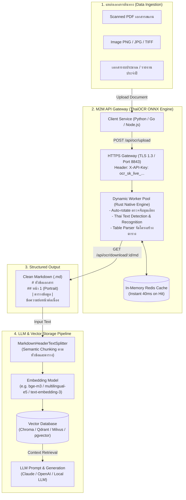

# Machine-to-Machine (M2M) API: Document Parser สำหรับ LLM & RAG Pipeline

คู่มือการเชื่อมต่อ **ThaiOCR ONNX REST API** ในรูปแบบ **Machine-to-Machine (M2M)** เพื่อแปลงเอกสารภาษาไทย (สแกน PDF / รูปภาพ) ออกมาเป็น **Structured Markdown** ส่งต่อเข้าสู่คลังความรู้ **RAG (Retrieval-Augmented Generation)** สำหรับ LLM

---

## 1. ปัญหาของ RAG กับเอกสารภาษาไทย และทำไมต้องใช้ ThaiOCR ONNX

| ปัญหาของ Parser ทั่วไป (pypdf, pdfminer, Cloud OCR) | จุดเด่นของ ThaiOCR ONNX ใน RAG Pipeline |
|---|---|
| **เอกสารสแกนอ่านไม่ได้:** PDF ราชการ/เอกสารองค์กรมักเป็นรูปสแกน ไม่มี Text layer | **OneOCR Neural Engine:** ถอดความตัวอักษรภาษาไทยได้แม้เป็นเอกสารสแกนเอียง หรือความละเอียดต่ำ |
| **สระ-วรรณยุกต์ซ้อนเพี้ยน:** Parser ทั่วไปมักอ่านสระบน-ล่าง สลับตำแหน่ง ทำให้ Embedding เพี้ยน | **Thai Vowel Stacking:** ถอดสระ วรรณยุกต์ ไม้ไต่คู้ ได้ลำดับถูกต้อง แม่นยำ 100% |
| **ตารางพัง กลายเป็นข้อความมั่ว:** Vector Search หาข้อมูลตัวเลขในตารางไม่เจอ | **Smart Table Parser:** แปลงตารางเป็น Markdown Table (`\| Col 1 \| Col 2 \|`) ให้ LLM อ่านเข้าใจทันที |
| **ความลับรั่วไหล:** การส่งเอกสารขึ้น Cloud OCR (Google, AWS) เสี่ยงผิดระเบียบความปลอดภัย/PDPA | **Offline 100% On-Premise:** รันบน Docker ภายในองค์กร ข้อมูลไม่หลุดออกนอกระบบแน่นอน |

---

## 2. สถาปัตยกรรมระบบ (Box Flow Diagram)

### 2.1 ภาพรวม RAG Ingestion Flow (Mermaid Diagram)



---

### 2.2 Box Architecture Diagram (Text Representation)

```
+-----------------------------------------------------------------------------------------+
|                              1. DATA SOURCES & INGESTION                                |
|  [ Scanned PDF Documents ]    [ Official Forms / Reports ]    [ Invoice / Budget Tables ]|
+-----------------------------------------------------------------------------------------+
                                             |
                                             v  (Multipart Upload)
+-----------------------------------------------------------------------------------------+
|                              2. THAIOCR ONNX M2M GATEWAY                                |
|                                                                                         |
|  [ Your Application / Worker ] ---> HTTPS Request (Header: X-API-Key: ocr_sk_live_...)  |
|                                                                                         |
|       +-------------------------------------------------------------------------+       |
|       | Nginx Reverse Proxy (Port 8843)                                         |       |
|       |  -> Authentication Guard (IP Permit + API Key Hash Validation)          |       |
|       |  -> Redis LRU Cache Check (Instant Return if File Hash Matches)         |       |
|       +-------------------------------------------------------------------------+       |
|                                            | (Cache Miss)                               |
|                                            v                                            |
|       +-------------------------------------------------------------------------+       |
|       | Rust Native Engine Pool (Docker Container)                              |       |
|       |  - Auto Page Orientation & Rotation (0, 90, 180, 270 deg)               |       |
|       |  - ONNX Runtime C API (OneOCR Model Execution on CPU)                   |       |
|       |  - Layout Analyzer & Table Markdown Structure Builder                   |       |
|       +-------------------------------------------------------------------------+       |
+-----------------------------------------------------------------------------------------+
                                             |
                                             v  (Export Structured Markdown)
+-----------------------------------------------------------------------------------------+
|                              3. STRUCTURED MARKDOWN OUTPUT                              |
|  - Headings: # Document Name, ## Page 1, ### Section Header                             |
|  - Clean Text: Paragraphs with correct Thai tone mark order                             |
|  - Markdown Tables: | Column A | Column B | (Preserved row-column semantics)            |
+-----------------------------------------------------------------------------------------+
                                             |
                                             v  (Chunking & Indexing)
+-----------------------------------------------------------------------------------------+
|                           4. LLM & VECTOR DATABASE (RAG)                                |
|                                                                                         |
|  [ LangChain / LlamaIndex Markdown Splitter ]  -->  Split by Markdown Headings          |
|                                                     (Keeps Tables & Headings Intact)    |
|                                            |                                            |
|                                            v                                            |
|  [ Embedding Model (bge-m3 / text-embedding-3) ]                                        |
|                                            |                                            |
|                                            v                                            |
|  [ Vector Store (ChromaDB / Qdrant / Milvus / pgvector) ]                               |
|                                            |                                            |
|                                            v  (Relevant Context)                        |
|  [ Large Language Model (LLM) ]  <======== Prompt + Retrieved Document Context          |
+-----------------------------------------------------------------------------------------+
```

---

## 3. ขั้นตอนการขอและตั้งค่า API Key

1. เข้าใช้งาน Web Portal ที่ `https://localhost:8843` (หรือ IP เซิร์ฟเวอร์ของคุณ)
2. เข้าสู่ระบบด้วยบัญชีผู้ดูแลระบบ (`admin`)
3. ไปที่เมนู **API Keys (Machine-to-Machine)**
4. คลิก **สร้าง API Key ใหม่**:
   - **ชื่อบริการ (Service Name):** เช่น `rag-ingestion-service`
   - **IP ที่อนุญาต (Allowed IPs):** กำหนด IP ของเครื่องที่เรียกใช้งาน (เช่น `192.168.1.50` หรือ `127.0.0.1` หรือ `*` สำหรับทุก IP)
   - **วันหมดอายุ:** กำหนดตามความต้องการ
5. คัดลอกค่า Key ที่ได้ เช่น `ocr_sk_live_9f82c1a4e6...` (บันทึกไว้ใน Environment Variable ของระบบคุณ)

---

## 4. ตัวอย่างการเรียกใช้งาน API (M2M Client Implementation)

### 4.1 ตัวอย่าง Python M2M Client Class

```python
import os
import time
import requests
from typing import Optional, Dict, Any

class ThaiOcrClient:
    """Client สำหรับเชื่อมต่อ ThaiOCR ONNX REST API แบบ Machine-to-Machine."""

    def __init__(self, base_url: str = "https://localhost:8843", api_key: str = None, verify_ssl: bool = False):
        self.base_url = base_url.rstrip("/")
        self.api_key = api_key or os.getenv("THAI_OCR_API_KEY")
        self.verify_ssl = verify_ssl
        self.headers = {
            "X-API-Key": self.api_key
        }

    def parse_document_to_markdown(self, file_path: str, timeout_sec: int = 300) -> str:
        """อัปโหลดเอกสาร (PDF หรือรูปภาพ) และรอรับผลลัพธ์เป็น Markdown."""
        if not os.path.exists(file_path):
            raise FileNotFoundError(f"File not found: {file_path}")

        filename = os.path.basename(file_path)
        upload_url = f"{self.base_url}/api/ocr/upload"

        # 1. ส่งคำขอประมวลผลเอกสาร
        with open(file_path, "rb") as f:
            files = {"file": (filename, f)}
            response = requests.post(
                upload_url,
                headers=self.headers,
                files=files,
                verify=self.verify_ssl,
                timeout=60
            )

        if response.status_code != 200:
            raise RuntimeError(f"Upload failed ({response.status_code}): {response.text}")

        job_data = response.json()
        job_id = job_data["job_id"]
        print(f"[*] Job created: {job_id} ({filename}) - processing...")

        # 2. ตรวจสอบสถานะจนกว่าจะเสร็จสิ้น
        start_time = time.time()
        while time.time() - start_time < timeout_sec:
            jobs_res = requests.get(
                f"{self.base_url}/api/ocr/jobs",
                headers=self.headers,
                verify=self.verify_ssl,
                timeout=10
            )
            if jobs_res.status_code == 200:
                jobs = jobs_res.json()
                current_job = next((j for j in jobs if j["id"] == job_id), None)
                if current_job:
                    status = current_job.get("status")
                    if status == "completed":
                        print(f"[OK] Job completed in {current_job.get('latency_ms', 0)}ms!")
                        break
                    elif status == "failed":
                        raise RuntimeError(f"OCR Job failed: {current_job.get('error_msg')}")

            time.sleep(1.5)

        # 3. ดึงผลลัพธ์ Markdown
        md_url = f"{self.base_url}/api/ocr/download/{job_id}/md"
        md_res = requests.get(md_url, headers=self.headers, verify=self.verify_ssl, timeout=30)
        if md_res.status_code != 200:
            raise RuntimeError(f"Failed to fetch markdown: {md_res.text}")

        return md_res.text


# ทดสอบใช้งาน
if __name__ == "__main__":
    client = ThaiOcrClient(
        base_url="https://localhost:8843",
        api_key="ocr_sk_live_your_actual_key_here",
        verify_ssl=False
    )

    markdown_content = client.parse_document_to_markdown("samples/sam2.pdf")
    print("\n--- ผลลัพธ์ Markdown สำหรับส่งให้ LLM ---")
    print(markdown_content[:500])
```

---

## 5. การนำผลลัพธ์ไปประกอบเข้า RAG Pipeline (LangChain Integration)

เมื่อได้ผลลัพธ์เป็น **Markdown** ที่มีโครงสร้างชัดเจน เราสามารถใช้ `MarkdownHeaderTextSplitter` เพื่อตัดแบ่ง Chunk ตามหัวข้อของเอกสารจริง ทำให้ตารางและย่อหน้าที่เกี่ยวข้องกันไม่ถูกตัดขาดออกจากกัน:

```python
from langchain_text_splitters import MarkdownHeaderTextSplitter
from langchain_community.vectorstores import Chroma
from langchain_openai import OpenAIEmbeddings

def ingest_to_vector_db(markdown_text: str):
    # 1. กำหนดโครงสร้างหัวข้อสำหรับตัดแบ่ง Chunk
    headers_to_split_on = [
        ("#", "Document"),
        ("##", "Page_or_Section"),
        ("###", "Sub_Section"),
    ]

    markdown_splitter = MarkdownHeaderTextSplitter(
        headers_to_split_on=headers_to_split_on,
        strip_headers=False
    )
    splits = markdown_splitter.split_text(markdown_text)

    print(f"[*] เอกสารแยกออกเป็น: {len(splits)} chunks คุณภาพสูง")
    for i, chunk in enumerate(splits[:3]):
        print(f"--- Chunk {i+1} Metadata: {chunk.metadata} ---")
        print(chunk.page_content[:200])

    # 2. ทำ Vector Embedding และบันทึกลง Vector Database
    # vectorstore = Chroma.from_documents(
    #     documents=splits,
    #     embedding=OpenAIEmbeddings(model="text-embedding-3-small")
    # )
    # return vectorstore

# ตัวอย่างการใช้งานร่วมกับ ThaiOcrClient
# md_text = client.parse_document_to_markdown("document.pdf")
# vector_db = ingest_to_vector_db(md_text)
```

---

## 6. สรุปความคุ้มค่าและประสิทธิภาพ (Value & Benchmarks)

1. **ความเร็วสูง:** หน้ากระดาษรูปภาพประมวลผลเฉลี่ย **~0.15 - 0.17 วินาที/หน้า** บน CPU ธรรมดา
2. **ประหยัดค่าใช้จ่าย:** ไม่มีค่าบริการรายหน้าแบบ Cloud OCR (Zero Cloud Cost)
3. **ความปลอดภัยระดับสูงสุด:** ทำงาน Offline 100% ตอบโจทย์สถาบันการเงิน หน่วยงานภาครัฐ โรงพยาบาล และองค์กรที่เคร่งครัดเรื่อง PDPA
4. **พร้อมใช้งานทันที:** รองรับทั้ง REST API, WebSocket live streaming และ Web Dashboard
